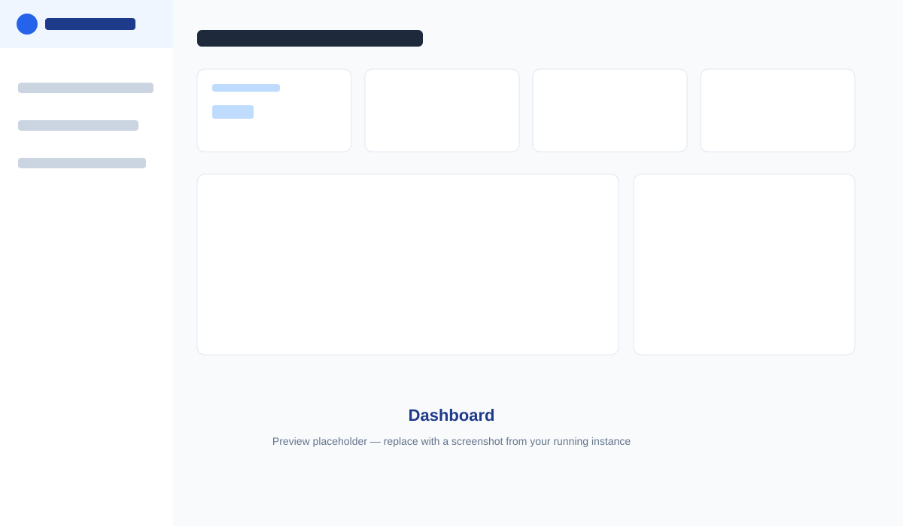
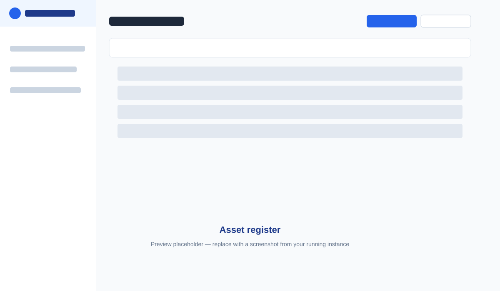
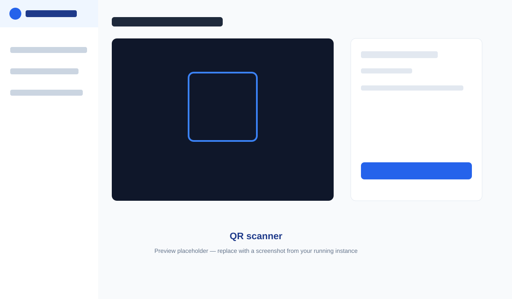

# AssetTag BD

[](https://github.com/RaiyanKhan19-41453-3/assettag-bd/actions/workflows/ci.yml)


**QR-based corporate IT & office asset tracking for Bangladesh.** AssetTag BD replaces messy Excel sheets with a searchable asset register, instant QR checkouts, a full assignment history and maintenance logs — all isolated per customer organisation.

> **Status:** portfolio / early-stage product. Core workflows are implemented, tested and containerised; see [Remaining work](#remaining-work) for what a production launch still needs.

## Preview

| Dashboard | Asset register | QR scanner |
|---|---|---|
|  |  |  |

<sub>Preview placeholders — replace `docs/screenshots/*.svg` with real captures from your running instance.</sub>

## Highlights

- **QR-first workflow** — every asset gets a unique tag and generated QR PNG; scan it to assign or return in seconds.
- **Multi-tenant by design** — `TenantId` on every tenant-owned table with EF global query filters; cross-tenant reads return 404.
- **Real audit trail** — assignment history, maintenance tickets, condition notes and returned dates; status is kept consistent with the underlying records.
- **Excel → labels pipeline** — bulk-import assets from `.xlsx`, get row-level validation errors, then print A4 sheets of QR labels in one request.
- **Modern auth** — JWT access tokens, hashed rotating refresh tokens, single-use password resets, `token_version` revocation and role-based authorisation.
- **Production-minded** — structured JSON logs, health probes, Prometheus metrics, secret files, Caddy TLS, backups with a tested restore path, and CI that smoke-tests the production stack.

## Stack

- **Backend:** ASP.NET Core 8 Web API, EF Core 8, PostgreSQL, Clean Architecture (Domain → Application → Infrastructure → API), MediatR + FluentValidation, BCrypt, JWT, QRCoder, ClosedXML, MailKit.
- **Frontend:** React 18 + TypeScript (Vite 8), TailwindCSS 3, React Router 7, TanStack Query 5, Axios, `html5-qrcode`.
- **DevOps:** multi-stage Dockerfiles, Nginx, Caddy with automatic HTTPS, Docker Compose, GitHub Actions.

## Quick start (Docker)

```bash
cp .env.example .env      # then edit the secrets
docker compose up -d --build
```

- Frontend: http://localhost:3000
- API: http://localhost:5080 (Swagger only when `ASPNETCORE_ENVIRONMENT=Development`)
- PostgreSQL: localhost:5432

The API applies EF migrations and seeds a default tenant with a SuperAdmin on startup. The login is whatever you set as `SEED_ADMIN_EMAIL` / `SEED_ADMIN_PASSWORD` in `.env` (the template uses `admin@example.com` / `change-me-admin-password`). **Change these values before exposing the app.** Demo credentials on the login page only appear when `VITE_SHOW_DEMO_CREDENTIALS=true` is passed to the frontend build. The Compose build passes `SEED_ADMIN_EMAIL` / `SEED_ADMIN_PASSWORD` through as `VITE_DEMO_EMAIL` / `VITE_DEMO_PASSWORD`, and only lists the sample manager/employee accounts when `SEED_SAMPLE_DATA=true`. See `frontend/.env.example`.

To onboard a customer, use **Create a company workspace** on the login screen (`POST /api/auth/signup-company`). That creates an isolated tenant plus its first SuperAdmin, who can invite IT Managers and Employees from the **Team** page. Public self-registration is disabled and emails are globally unique.

To browse Swagger with the Docker stack, set `ASPNETCORE_ENVIRONMENT=Development` in `.env` and recreate the API container (`docker compose up -d --force-recreate api`). Set `SEED_SAMPLE_DATA=true` at the same time for demo assets.

```bash
docker compose logs -f api
docker compose down                 # keep the database volume
docker compose down -v              # also delete the database
```

## Local development (without Docker)

```bash
docker run -d --name assettagbd -e POSTGRES_PASSWORD=postgres \
  -e POSTGRES_DB=assettagbd -p 5432:5432 postgres:16-alpine

dotnet restore AssetTagBD.sln
dotnet run --project src/AssetTagBD.API

# separate terminal
cd frontend && npm install && npm run dev
```

Set `VITE_API_URL=http://localhost:5080/api` in `frontend/.env` (see `.env.example`).

## Roles

| Role | Capabilities |
|---|---|
| SuperAdmin | Everything, including deleting assets and inviting privileged users |
| ITManager | Create/update assets, assign/return, scan, resolve maintenance, import |
| Employee | View assets, see **My assets** (items checked out to them), report maintenance issues |

The asset list is server-paginated (12 per page, sortable by name/tag/purchase date/status). Asset status stays consistent with the assignment record: an asset cannot be marked Assigned without an active assignment, or Available while one exists — use the Assign/Return actions instead. A database-level unique index guarantees at most one active assignment per asset even under concurrent requests.

## Project layout

```
src/
  AssetTagBD.Domain/         Entities, enums, no dependencies
  AssetTagBD.Application/    DTOs, validators, MediatR features, interfaces
  AssetTagBD.Infrastructure/ EF Core, repositories, JWT/BCrypt/QR/Excel/email services, migrations
  AssetTagBD.API/            Controllers, auth, exception middleware, health, metrics, seeding
frontend/                    React SPA (services → hooks → components → pages)
tests/                       45 xUnit integration + HTTP-pipeline tests
docker-compose*.yml          Development and production stacks
monitoring/                  Prometheus scrape config and alert rules
scripts/                     Backup and restore scripts
```

## Authentication

Access tokens are short-lived JWTs; refresh tokens are **hashed at rest**, expire after 7 days and **rotate on every use** (a replayed token is rejected). Password reset links are single-use, hashed, expire after one hour, and revoke every active session via a `token_version` stamp that is validated on each request.

`POST /api/auth/forgot-password` always returns the same message so account existence is never disclosed. Reset emails are sent through `SmtpEmailSender` when `Email:Smtp:Host` is configured (`SMTP_HOST` + `SMTP_USER` + `secrets/smtp_password.txt` in production). Without SMTP, a logging fallback is used **only** in dev/demo (`AUTH_EXPOSE_RESET_TOKEN=true`); in production it fails loudly rather than silently dropping emails. Requests are throttled to 5 per email per hour and issuing a new link invalidates earlier ones.

## Excel import & QR labels

IT Managers can bulk-import assets from **Assets → Import Excel**. The first worksheet must have a header row; recognised columns (case-insensitive, spaces optional) are:

| Column | Aliases | Required |
|---|---|---|
| Name | Asset Name, Asset | yes |
| Purchase Date | Purchase | yes |
| Category | Type | no (defaults to Other) |
| Asset Tag | Tag | no (auto-generated when blank) |
| Serial Number | Serial | no |
| Warranty Expiry Date | Warranty, Warranty Expiry | no |

Invalid rows are skipped with a row-numbered error list; valid rows are inserted in one transaction. **Print QR labels** opens an A4 sheet (3 × 8 labels) using a single batch request (up to 500 tags). A single label can also be printed from the asset detail page.

## Tests

Integration tests run against real PostgreSQL Testcontainers, so Docker must be running:

```bash
dotnet test AssetTagBD.sln
```

The 45 tests cover tenant isolation, company sign-up, invite-only registration, assignments, maintenance, import, pagination, token rotation/revocation, and an HTTP pipeline suite using `WebApplicationFactory` for auth status codes, role gates and cross-tenant 404s. CI runs the backend build + tests, frontend typecheck/build, Docker image builds, Caddy config validation and a production-stack auth smoke test on every push and PR.

## Production deployment

`docker-compose.prod.yml` adds automatic TLS via Caddy (Let's Encrypt) and mounts secrets as files.

```bash
mkdir -p secrets
printf 'a-long-random-jwt-secret-at-least-32-chars' > secrets/jwt_secret.txt
# Username must match POSTGRES_USER and password must match db_password.txt.
printf 'Host=db;Port=5432;Database=assettagbd;Username=postgres;Password=a-strong-database-password' > secrets/db_connection.txt
printf 'a-strong-database-password' > secrets/db_password.txt
printf 'a-strong-initial-admin-password' > secrets/admin_password.txt
printf 'unused-if-no-smtp' > secrets/smtp_password.txt

export DOMAIN=assets.example.com
export EMAIL=you@example.com
docker compose -f docker-compose.prod.yml up -d --build
```

The API reads secrets through `SecretReader` (`JWT_SECRET_FILE`, `ConnectionStrings__DefaultConnection_FILE`, `Seed__AdminPassword_FILE`, `Email__Smtp__Password_FILE`), so images are identical across environments. Caddy proxies only `/api/*` to the API; no application port is published publicly. Health probes and `/metrics` are intentionally **not** routed through Caddy — scrape them on the internal Docker network (`api:8080`).

### Health, logs and metrics

- `/health/live` — process liveness (no dependencies)
- `/health/ready` — database connectivity
- `/metrics` — Prometheus metrics from `prometheus-net`
- Structured JSON logs on stdout (Serilog): `docker compose logs api | jq .`

Example Prometheus scrape config and alert rules are in `monitoring/`.

### Backups

```bash
scripts/backup.sh                       # backups/assettagbd_<timestamp>.dump.gz
ASSUME_YES=1 scripts/restore.sh backups/assettagbd_....dump.gz
# production:
COMPOSE_FILE=docker-compose.prod.yml scripts/backup.sh
```

Restore stops the API, recreates a clean schema and restores with `--single-transaction --exit-on-error`. Backups retain 14 days. **Test restores regularly** — a backup that has never been restored is only a hypothesis.

## Configuration

Runtime settings can be overridden with environment variables (see `.env.example`): `ConnectionStrings__DefaultConnection`, `Jwt__*`, `Seed__*`, `Auth__ExposeResetTokenInResponse`, `Email__Smtp__*`, `Cors__AllowedOrigins__*`.

## Remaining work

This is a strong MVP, not a finished commercial product. Before selling to real clients:

- Replace the dev logging email fallback with a real SMTP provider and add an email verification flow.
- Add off-site backup storage and a scheduled restore drill; deploy Prometheus/Alertmanager from `monitoring/`.
- Add pagination to secondary lists (users, history, logs) and soft-delete/archival for audit history.
- Add API-rate limiting at the edge and a distributed throttle instead of the in-process one.
- Add a privacy policy, terms and a live demo URL for the portfolio.
